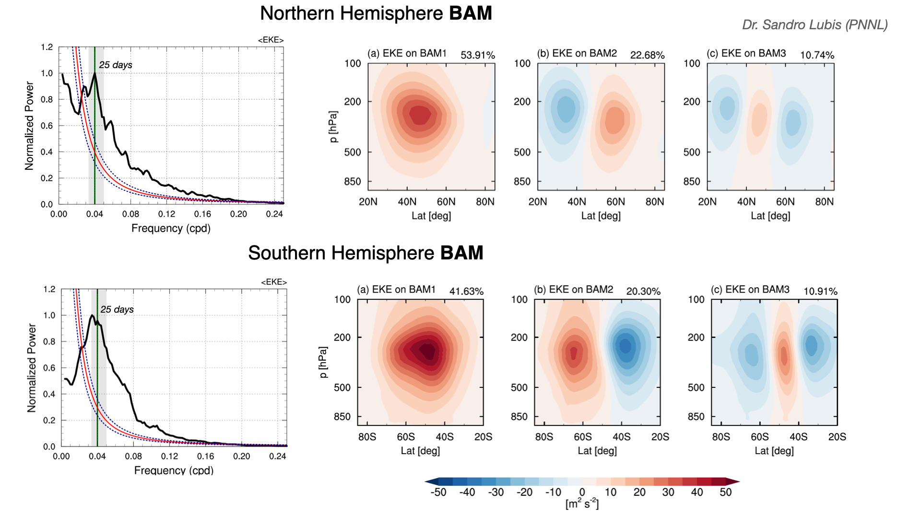

# Baroclinic Annular Mode (BAM) Index (1979-2020)

**Sandro W. Lubis, Ph.D.**
Pacific Northwest National Laboratory (PNNL)

This repository provides daily principal component (PC) time series of the first three empirical orthogonal function (EOF) modes of zonal-mean eddy kinetic energy (EKE) for the Northern Hemisphere (NH) and Southern Hemisphere (SH) during 1979–2020 based on ERA5 Reanalysis.

## Citation

If you use these BAM indices in your research, please cite:

Lubis, S. W., Leung, L. R., & Battalio, J. M. (2026). **More Frequent Atmospheric Rivers and Associated Precipitation Extremes Induced by the Baroclinic Annular Mode.** *Geophysical Research Letters* (Accepted).

## Methodology

The BAM is defined separately for each hemisphere as the leading EOF of zonal-mean EKE over 20°–70° latitude and 1000–200 hPa (Thompson & Woodworth, 2014, Lubis et al., 2026).

The seasonal cycle is removed, and the data are weighted by √cos(φ), where φ is latitude. For NH BAM, zonal wavenumbers less than 4 are removed from the wind fields before calculating EKE to exclude planetary-scale wave contributions (Thompson & Li, 2015, Lubis et al., 2026).

Positive and negative BAM events are identified using a 5-day smoothed BAM index exceeding ±1 standard deviation.

  

  <b>Figure 1.</b> Spatial structure and power spectrum of the Baroclinic Annular Mode (BAM) in the Northern and Southern Hemispheres.

## Data Files

### TXT Files
- `BAM_index_NH_1979_2020.txt` — Northern Hemisphere
- `BAM_index_SH_1979_2020.txt` — Southern Hemisphere

Each TXT file contains five columns:

year mon day bam(nrm) bam(non-nrm)

- `year`, `mon`, `day`: Date
- `bam(nrm)`: Normalized BAM index (PC1)
- `bam(non-nrm)`: Unnormalized BAM index (PC1)

### NetCDF Files
- `pc.eke_NH_1979_2020.nc` — Northern Hemisphere
- `pc.eke_SH_1979_2020.nc` — Southern Hemisphere

Each file contains daily PC time series: `pc(evn, time)`.

- PC1: Baroclinic Annular Mode (BAM)
- PC2: Second EOF mode
- PC3: Third EOF mode

All datasets cover 1979–2020 (15,341 daily values).

